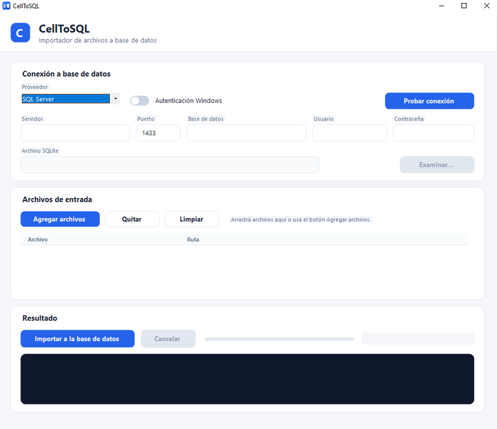

# CellToSQL

**CellToSQL** es una aplicación de escritorio para Windows que traslada el
contenido de archivos Excel, CSV, TXT, PDF y Word a bases de datos
relacionales, infiriendo tipos y generando el esquema automáticamente.
Diseñado específicamente para analistas de sistemas, datos y equipos de TI
que reciben información en planillas y necesitan dejarla consultable en
SQL, *CellToSQL* reemplaza el ciclo manual de abrir cada archivo, escribir
`CREATE TABLE` y armar los `INSERT` uno por uno, y lo convierte en una
operación de arrastrar, soltar e importar.

Con extracción multipropósito, inferencia de tipos por columna, DDL
específico por motor e inserción parametrizada en transacciones, el
proyecto permite publicar datos limpios y consultables en SQL Server,
PostgreSQL, MySQL o SQLite en cuestión de minutos.

### 📸 Capturas de pantalla

## ✨ Características Principales

* **Soporte multi-motor:** conexión a SQL Server, PostgreSQL, MySQL y SQLite
  desde la misma interfaz, con DDL y tipos de columna generados según el
  proveedor seleccionado.

* **Ingesta por arrastrar y soltar:** carga simultánea de múltiples archivos
  `.xlsx`, `.xlsm`, `.csv`, `.txt`, `.tsv`, `.log`, `.pdf` y `.docx`, con
  detección de formato por extensión y validación previa al encolado.

* **Inferencia de tipos automática:** análisis del conjunto de valores de
  cada columna para asignar el tipo más específico que los contenga a todos
  (entero, decimal, fecha o texto).

* **Mapeo origen → tabla:** cada hoja de Excel, cada tabla de Word y cada
  archivo plano se convierte en una tabla independiente con nombre derivado
  del archivo y la hoja.

* **Saneamiento de identificadores:** normalización de nombres de tabla y
  columna, resolución de duplicados con sufijos y protección contra nombres
  inválidos o que colisionan con palabras reservadas del motor.

* **Importación transaccional:** inserción parametrizada fila por fila con
  `COMMIT`/`ROLLBACK` por tabla, evitando cargas parciales ante cualquier
  error a mitad de proceso.

* **Interfaz propia:** controles dibujados con GDI+ (tarjetas redondeadas,
  botones con estados hover/pressed, campos con foco resaltado, toggle switch
  y log tipo consola), sin frameworks de UI externos.

## ⚙️ ¿Qué Hace? (Módulos Disponibles)

Desde la lectura del archivo hasta la escritura en la base, *CellToSQL*
implementa los siguientes componentes:

1. **Enrutador de formatos** (`Services/FileExtractorService.cs`): resuelve
   la extensión del archivo y deriva al extractor correspondiente detrás de
   la interfaz `IFileExtractor`.

2. **Extractor Excel** (`Services/ExcelExtractor.cs`): recorre libros con
   ClosedXML y convierte cada hoja usada en una tabla, preservando los tipos
   nativos de celda (número, fecha, booleano, texto).

3. **Extractores de texto plano y PDF** (`Services/CsvExtractor.cs`,
   `Services/PdfExtractor.cs`): autodetecta el delimitador y parsea CSV con
   soporte de comillas; el lector PDF descomprime flujos `FlateDecode` y
   extrae texto sin dependencias externas.

4. **Extractor Word** (`Services/WordExtractor.cs`): recorre el `.docx` con
   el SDK OpenXML, convirtiendo cada tabla del documento en una tabla SQL y
   los párrafos sueltos en una tabla de contenido.

5. **Constructor de esquema** (`Services/SchemaBuilder.cs`): analiza los
   valores por columna, infiere el tipo de dato y sanea y deduplica los
   identificadores antes de generar la definición.

6. **Capa de datos y orquestación** (`Services/DatabaseService.cs`,
   `Services/ImportService.cs`): genera el DDL por proveedor, abre
   transacciones y ejecuta los `INSERT` parametrizados con normalización de
   valores nulos y conversión de tipos.

## 🛠️ Tecnologías Utilizadas

* **Lenguaje y runtime:** C#, .NET 8, Windows Forms, GDI+.

* **Acceso a datos:** Microsoft.Data.SqlClient, Npgsql, MySqlConnector,
  Microsoft.Data.Sqlite, ADO.NET.

* **Procesamiento de documentos:** ClosedXML, DocumentFormat.OpenXml, lector
  PDF propio sobre `DeflateStream` y `System.IO.Compression`.

* **UI y distribución:** controles personalizados, `dotnet publish`
  self-contained `win-x64`, Inno Setup 6.

## 🚀 Instalación y Uso

1. Descargá el instalador desde la sección [**Releases**](../../releases).

2. Ejecutá `CellToSQL_v1.0.0_setup_x64.exe`.

*Nota:* El instalador solicita privilegios de **Administrador (UAC)** porque
escribe en `C:\Program Files`. La aplicación se ejecuta después sin
elevación y no requiere permisos especiales para operar.

3. Se creará un acceso directo en el Menú Inicio (y opcionalmente en el
Escritorio) con el logo de CellToSQL como ícono.

4. Abrí **CellToSQL**, seleccioná el motor, completá los datos de conexión,
presioná **Probar conexión**, arrastrá los archivos y ejecutá **Importar a
la base de datos**.

## 👨‍💻 Autor

Desarrollado por **Yuri Alexander Pagel Krüger**
